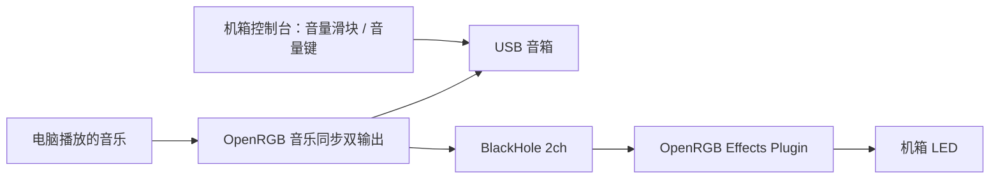

# OpenRGB macOS Manager · 机箱控制台

一个原生 Swift / AppKit 菜单栏工具，把 **OpenRGB 机箱灯光、电脑音乐同步和音箱音量** 放进同一个管理窗口。

[](https://github.com/ychen0606/openrgb-macos-manager/actions/workflows/build.yml)
[](LICENSE)

Native macOS menu bar companion for OpenRGB: static lighting, music-reactive LEDs, BlackHole audio routing, and speaker volume/media keys. The interface and primary documentation are in Simplified Chinese.

## 功能

| 模式 / 功能 | 行为 |
| --- | --- |
| 普通灯光 | 固定颜色；选色后自动应用，亮度滑块松开后应用 |
| 音乐同步 | OpenRGB Effects Plugin 分析 BlackHole 输入，机箱跟随电脑音乐变化 |
| 关灯 | LED 设为黑色，停止音乐灯效，保留正常音箱输出 |
| 音箱音量 | 菜单栏与窗口滑块、静音，以及双输出模式下的键盘音量键 |
| 登录启动 | 选择普通灯光、音乐同步或上次模式 |
| 自动重连 | 检测 SDK 断开，尝试启动 OpenRGB 并恢复保存的模式 |
| 失败恢复 | 模式切换失败时，尝试恢复先前的灯光配置和音频路由 |

关闭控制台窗口后，程序继续留在菜单栏。OpenRGB 作为后台灯光服务运行。

## 适用范围

这是从一台实际使用的电脑上整理出的项目，已验证的硬件是 **Gigabyte IT5701 机箱灯光控制器 + 双声道 USB AUDIO 音箱**。当前管理一个选定的灯光控制器及其全部区域。

- 构建目标为 macOS 12+；实际硬件验证在 macOS 26.7.1 / Intel 上完成。较旧系统和其他硬件仍需验证。
- 需要 **OpenRGB 1.1、SDK 协议 6、Effects Plugin 1.1**；其他版本的配置和协议兼容性没有保证。
- 音乐模式需要 **BlackHole 2ch**，验证版本为 0.7.1。
- 控制器需要 `Direct` 模式；音箱需要双声道输出，以及可写的主音量和静音属性。
- 源码支持按本机标识配置设备，这不代表所有 RGB 控制器、HDMI 音频或蓝牙音箱都已兼容。
- 本仓库提供源码构建方式，尚无经过 Apple 公证的安装包。

## 快速开始

先安装 [OpenRGB](https://openrgb.org/)、[Effects Plugin](https://openrgb.org/plugins.html) 和 [BlackHole 2ch](https://existential.audio/blackhole/)。在 OpenRGB 中确认机箱灯能控制，并保存一个名为 `default` 的配置。完整步骤见 [安装与配置](docs/SETUP.zh-CN.md)。

安装 Xcode Command Line Tools，并确保有 Python 3：

```sh
xcode-select --install
git clone https://github.com/ychen0606/openrgb-macos-manager.git
cd openrgb-macos-manager
./scripts/build.sh
python3 scripts/configure.py --list
```

从列表选择实际音箱 UID 和灯光控制器索引。**索引不是固定值，以自己的输出为准。** 先预览，再写入配置：

```sh
python3 scripts/configure.py --speaker-uid '你的音箱 UID' --controller-index 0 --dry-run
python3 scripts/configure.py --speaker-uid '你的音箱 UID' --controller-index 0
./scripts/install.sh
open "$HOME/Applications/OpenRGB Volume.app"
```

配置工具只写本机配置文件，不启动应用、不切换音频、不改变当前灯光。已存在配置时会拒绝覆盖；确认需要重建后使用 `--replace`，工具会备份旧设备及音乐配置，并保留已有颜色、亮度和启动设置。

安装脚本默认放到 `~/Applications/OpenRGB Volume.app`。若旧控制台仍在运行，会提示先退出；更新前备份旧应用。单独构建不会更新已安装的版本。

首次启用音乐同步时，在 OpenRGB 的音频设备选项中确认输入为 BlackHole，并允许 macOS 的音频输入权限。键盘音量键需要给 **OpenRGB Volume** 辅助功能权限。

## 音乐与音量如何联动



控制台只调节音箱的音量，不降低送给灯效的虚拟音频信号。普通灯光和关灯模式停止音乐效果，并将默认输出切回音箱。

macOS 会把 BlackHole 的音频读取显示为输入使用指示；系统没有只隐藏某个虚拟输入指示的正常开关。切到普通或关灯模式可以停止这项读取。管理器本身不录音、不上传音频，按键处理只用于音量和静音；音频分析由 Effects Plugin 执行。

## 开发与验证

```sh
./scripts/check.sh
```

这会检查 Python 配置逻辑、Swift 灯光配置生成、Shell 语法，并构建和校验应用签名。测试使用临时目录，不改变真实灯光、音量或当前运行的应用。GitHub Actions 运行相同检查。

```text
Sources/       原生窗口、菜单栏、音频路由、SDK 与设备配置
Resources/     应用图标与 Info.plist
config/        无本机标识的音乐灯效模板与配置示例
scripts/       构建、安装、本机配置、图标生成和检查工具
tests/         配置保留、失败恢复、设备匹配和亮度测试
docs/          安装、架构、故障排查和验证记录
```

默认构建当前机器架构。可通过 `ARCH=x86_64` 或 `ARCH=arm64` 交叉编译，`BUILD_DIR` 指定产物目录。默认使用本地临时签名；有正式签名身份时可设置 `SIGN_IDENTITY`。每次重新签名后，macOS 可能要求重新登记辅助功能授权。

- [安装与配置](docs/SETUP.zh-CN.md)
- [故障排查](docs/TROUBLESHOOTING.zh-CN.md)
- [架构与命令行](docs/ARCHITECTURE.md)
- [验证范围](docs/TESTING.md)
- [更新记录](CHANGELOG.md)

## 许可证与依赖

本仓库的管理器源码、脚本和图标使用 [MIT License](LICENSE)。OpenRGB、Effects Plugin 和 BlackHole 需要单独安装，遵循各自的许可证；仓库不打包这些程序。项目不是 OpenRGB 官方客户端。
